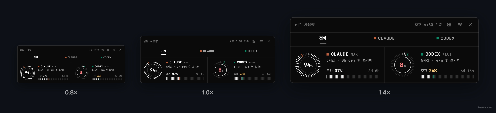

<div align="center">

# usage-gauge

**How much of every AI you have left, and when it runs out.**

Claude · Codex · Gemini · Cursor · Copilot … remaining usage in a floating gauge and your menu bar.<br>
Twelve graph forms and three styles, in a panel that responds to your touch.

[](https://github.com/Power-xc/usage-gauge/actions/workflows/ci.yml)
[](https://github.com/Power-xc/usage-gauge/releases/latest)


[](LICENSE)


**[Download](https://github.com/Power-xc/usage-gauge/releases/latest)** · [12 graphs](#12-graphs) · [Styles](#3-styles) · [Interaction](#interaction) · [Install](#install) · [Usage](#usage) · [한국어](README.md)

</div>

The interface is in Korean; the tables below give the English meaning of each label.

## At a glance

- **Every AI in one panel** — everything you turned on among 100+ services: Claude, Codex, Gemini, Cursor, Copilot, Windsurf, Grok, OpenRouter and more. Claude and Codex come first, the rest follow in the order you enabled them.
- **Know when it runs out** — the pace of the last hour turns into "empty in 28 min". If the allowance outlasts the reset, it says you have room.
- **12 graphs × 3 styles** — from a dial to a trend curve, a histogram or a constellation, drawn as a mono terminal, an iris glass or a dot matrix. Your pick is remembered.
- **Responds to touch** — click a service tab for its detail page, hover to see when it resets, switch graphs right from the header. Size from 0.7× to 1.6×, opacity from 30% to 100%.
- **Always in the menu bar** — two bars and the remaining % per service, even with the panel hidden.
- **No permissions, no tokens** — it never asks for screen recording or accessibility access, and it neither reads nor stores account tokens.

## 12 graphs

The same numbers in twelve shapes. Switch with the header's graph button or menu → 그래프 (Graph).


| Graph                | What it shows                                                                       | Use it when                   |
| -------------------- | ----------------------------------------------------------------------------------- | ----------------------------- |
| 다이얼 Dial          | The short window (5 h, daily) as a dial, the long one (weekly, monthly) as a bar    | Default. Both windows at once |
| 바 Bars              | Both windows as two horizontal bars                                                 | Many services, densely        |
| 숫자 Figures         | One large figure and a one-line summary                                             | The smallest footprint        |
| 막대 그래프 Columns  | Both windows of every service as vertical columns, side by side                     | Comparing services            |
| 캡슐 Capsule         | A pill-shaped battery filled to what is left                                        | Reading it at a glance        |
| 눈금자 Ruler         | A line rising over a ruler that bulges at the current value, with a large figure    | Exact values, large           |
| 궤도 Orbit           | Every service as one concentric ring, the lowest value in the centre                | Finding the most urgent one   |
| 별자리 Constellation | A map of short × long window remaining, with each service's path over the last hour | Room vs. pressure on one page |
| 추이 Trend           | How the current window drained, plus a projected empty line                         | When will it run out          |
| 히스토그램 Histogram | How much you used in each slice of the window                                       | When you used it in bursts    |
| 스파크 바 Spark bars | Remaining bars over a strip of hourly history                                       | A list with the flow          |
| 버스트 Burst         | The window wrapped like a clock, usage per slice as rays                            | The rhythm of your day        |

Trend, histogram, spark bars, burst and the constellation paths are drawn from a history the app records every two minutes. Right after installing they read "기록 중" (recording) and fill in within minutes.

## 3 styles

Pick one from menu → 스타일 (Style). Numbers and rules are the same in every style.


| Style                               | Surface                                | Drawing                                                  |
| ----------------------------------- | -------------------------------------- | -------------------------------------------------------- |
| 모노 터미널 Mono terminal (default) | A black sheet with hairline grid rules | Radial tick dial, vertical tick bars, monospaced figures |
| 홍채 · 글래스 Iris glass            | Clear smoked glass with no grey cast   | A crisp single-colour iris dial, thin bars               |
| 도트 매트릭스 Dot matrix            | A flat charcoal card                   | Dot-column rings, LED dot figures, dot strips            |

Every service has its own colour — Claude terracotta, Codex emerald, Gemini blue, Copilot violet. Services without one get a colour derived from their name, so it never changes. At 30% or less the figure turns yellow, at 10% or less coral.

## Interaction

The panel is not just something to look at. All twelve graphs respond the same way.


- **Tabs and details** — pick a service in the tab row under the header, or click its cell, and its own page opens: a large dial, what is left in both windows, the reset time ("오후 8:50 초기화 · 3시간 50분 후", resets at 8:50 PM, in 3 h 50 min) and when it was measured. 전체 (All) takes you back. With many services the tabs shrink from names to short names to colour marks, so they never collide.
- **Hover** — hover a service and it brightens, its cell takes a faint tint of its colour, and the caption turns into "초기화 오후 5:47 · 측정 4:50" (resets 5:47 PM · measured 4:50). Graphs that draw everyone in one picture, like orbit and constellation, sharpen the hovered service and dim the rest.
- **Switch graphs in place** — the header's graph button opens a row of twelve icons. Pick one and the panel changes smoothly, with the window following its size.
- **Size and opacity** — the header's opacity · size button shows two bars. Drag them for 0.7–1.6× and 30–100%; text and drawings stay crisp at any size.



- **Values that glide** — when a value changes, dials and bars slide to it. With the system's Reduce Motion on, they change instantly.
- **Menu bar** — with the panel hidden, the menu bar keeps two bars per service (short and long window) and the remaining %. You can turn the bars off in the menu.


## Install

### macOS 14 or later

On macOS 26 the panel is Liquid Glass; earlier versions get a blurred glass.

1. **Install the usage CLI** — the tool that reads each service's usage. Afterwards, turn on the services you want in the settings of the app it installs and sign in to them. That app does not need to keep running.

   ```sh
   brew install --cask codexbar
   ```

2. **Get the app** — download `UsageGauge-macOS.zip` from [Releases](https://github.com/Power-xc/usage-gauge/releases/latest), unzip it and move `UsageGauge.app` to Applications. It runs natively on Apple silicon and Intel.

3. **Open it the first time** — it is an open-source app without Apple notarization, so macOS warns on first launch. Click **Open Anyway** at the bottom of System Settings → Privacy & Security, or run:

   ```sh
   xattr -dr com.apple.quarantine /Applications/UsageGauge.app
   ```

On first launch it registers itself to start at login. Toggle it with 로그인할 때 켜기 (Start at login) in the menu.

<details>
<summary>Build from source</summary>

Needs Swift 5.9 or later (Xcode or the Command Line Tools).

```sh
git clone https://github.com/Power-xc/usage-gauge.git
cd usage-gauge
scripts/install.sh      # install into ~/Applications and launch
scripts/uninstall.sh    # remove
```

</details>

### Windows 10/11

Download `UsageGauge_…_x64-setup.exe` from [Releases](https://github.com/Power-xc/usage-gauge/releases/latest) and run it. If SmartScreen shows "Windows protected your PC", choose **More info → Run anyway**.

The Windows build reads the official usage of Claude and Codex directly with the sign-in files of Claude Code and the Codex CLI. Graphs, styles and interaction match macOS; toggle the panel from the tray icon or with `Ctrl+Alt+U`. See [windows/README.md](windows/README.md) for details.

## Usage

| Action                           | How                                                                       |
| -------------------------------- | ------------------------------------------------------------------------- |
| Show or hide the gauge           | Click the menu bar item · `⌥⌘U` · the panel's ×                           |
| Service details                  | Click a tab or a service cell; 전체 (All) takes you back                  |
| When it resets                   | Hover a service                                                           |
| Change the graph                 | The header's graph button, or menu → 그래프 (Graph)                       |
| Change the style                 | Menu → 스타일 (Style)                                                     |
| Size and opacity                 | The header's opacity · size button → drag the bars, or the menu's sliders |
| Move it                          | Drag the header or a cell; it stays where you left it                     |
| Menu bar bars                    | Menu → 메뉴바에 막대 표시 (Show bars in the menu bar)                     |
| Glass that follows the wallpaper | Menu → 배경에 맞춰 유리 진하기 조절                                       |
| Start at login                   | Menu → 로그인할 때 켜기                                                   |
| Refresh now                      | Menu → 지금 새로고침                                                      |

Right-click the menu bar item or the panel to open the menu.

## Data and privacy

- **Numbers as each service reports them** — the gauge only interprets the official usage values; it never estimates. It reads again every two minutes, when your Mac wakes, when you open the panel and right after a reset time passes. The header's "오후 4:50 기준" (as of 4:50 PM) is the oldest measurement on screen.
- **History stays on your Mac** — for the projection and the history graphs it keeps only service ids, measurement times and remaining % for the last 26 hours in `~/Library/Application Support/UsageGauge/history.json`. Delete the file to start over.
- **Tokens are left alone** — the macOS app neither reads nor stores account tokens (sign-in is handled by the usage CLI). The Windows app reads a token from the sign-in file on every request and sends it only over HTTPS to `api.anthropic.com` or `chatgpt.com`; it never logs, stores, refreshes or hands it to the web view.
- **No permissions** — the glass tint follows the brightness of your wallpaper image file, so it needs no screen recording access.

<details>
<summary>How the numbers are interpreted</summary>

| Situation                   | What the gauge does                                                                               |
| --------------------------- | ------------------------------------------------------------------------------------------------- |
| A reset time has passed     | Shows 100% at once without waiting for the next response, then reads again to confirm             |
| Rounding                    | Never shows 0% while something is left or 100% while something is used (99.6% used → 1%)          |
| One service's request fails | Keeps the last good value, and the header time stays at its measurement so you can tell it is old |
| Never read successfully     | Shows "연결 안 됨" (not connected) with the reason                                                |
| Projection                  | Only with 10+ minutes of history in the last hour and actual use; if the reset comes first, room  |
| Time until reset            | Recomputed every 15 seconds                                                                       |

All of these rules live in `UsageGaugeCore`, and `swift run CoreChecks` checks them as written.

</details>

## Development

```sh
swift build && swift run CoreChecks       # build and check the core rules
scripts/render-media.sh                    # render the README images and demo GIF (needs ffmpeg)
cd windows && npm ci && npm run build && (cd src-tauri && cargo test)
```

Every image and demo in this README is the app's own SwiftUI views rendered with sample data.

## License

[MIT](LICENSE)
