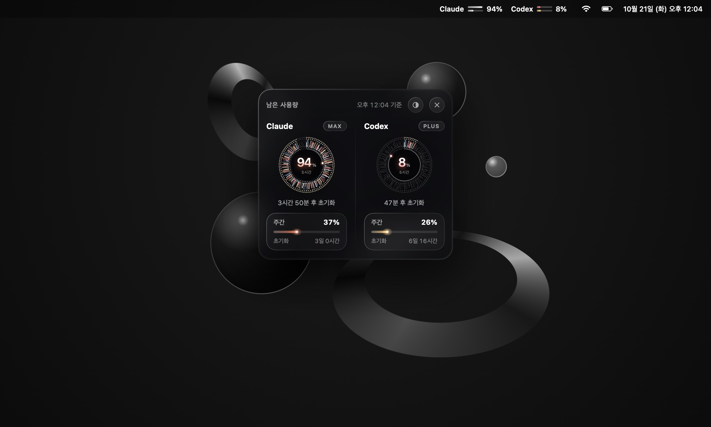
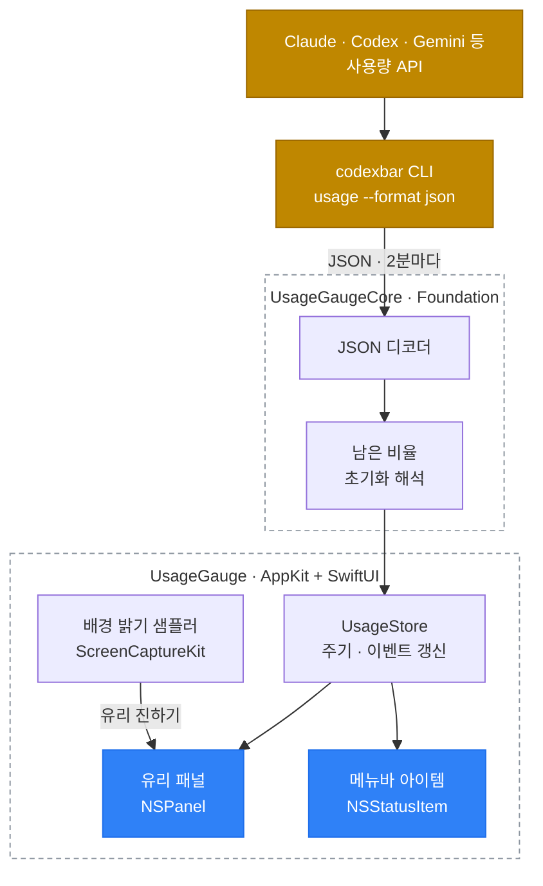

# usage-gauge

Claude·Codex 같은 AI 코딩 도구의 **남은 사용량**을 macOS 화면 위에 떠 있는 유리 게이지와 메뉴바로 보여주는 앱입니다. 한도가 얼마나 남았는지, 언제 초기화되는지를 작업 중에 시선만 돌려 확인할 수 있습니다.



## 기능

- **남은 사용량 다이얼** — 5시간 같은 짧은 창은 홍채 모양 다이얼로, 주간·월간 창은 빛줄기 바로 보여줍니다. 남은 만큼 결이 밝게 켜지고, 각 도구의 고유색이 섞입니다.
- **초기화까지 남은 시간** — 동공 테두리가 시계 역할을 합니다. 창이 시작된 12시 방향부터 지금까지가 밝아지고, 점이 한 바퀴를 돌면 초기화됩니다. 아래에 "3시간 50분 후 초기화"처럼 글로도 표시합니다.
- **연결한 모든 서비스** — CodexBar에 켜 둔 서비스(Claude, Codex, Gemini, Cursor, Copilot 등)를 한 패널에 모두 보여줍니다. Claude와 Codex가 항상 앞에 옵니다.
- **색으로 먼저 알림** — 30% 이하는 노랑, 10% 이하는 산호색으로 바뀝니다.
- **메뉴바 세트** — 패널을 꺼 두어도 메뉴바에 도구별 막대 두 줄(짧은 창·주간)과 남은 %가 항상 보입니다.
- **배경에 맞춘 유리** — 뒤가 밝으면 유리가 진해지고 어두우면 맑아집니다(화면 기록 권한 필요, 끄기 가능).
- **투명도 조절** — 패널의 ◐ 버튼을 누르면 나오는 바를 드래그하거나, 우클릭 메뉴의 슬라이더로 조절합니다.

| 연결한 모든 서비스                     | 남은 양에 따른 색             |
| -------------------------------------- | ----------------------------- |
|  |  |


## 요구 사항

- macOS 14 이상 (Liquid Glass 유리는 macOS 26부터, 그 이전은 블러 유리로 대체)
- [CodexBar](https://codexbar.app) — 사용량을 읽어 오는 CLI가 함께 설치됩니다
- Swift 5.9 이상 (Xcode 또는 Command Line Tools)

```sh
brew install --cask codexbar
```

CodexBar에서 보고 싶은 서비스에 로그인해 두면 됩니다. 메뉴바 앱 자체는 켜 둘 필요가 없습니다 — 게이지는 CLI만 사용합니다.

## 설치

```sh
git clone https://github.com/Power-xc/usage-gauge.git
cd usage-gauge
scripts/install.sh
```

`~/Applications/UsageGauge.app`에 설치되고 로그인할 때 자동으로 켜집니다. 지우려면 `scripts/uninstall.sh`를 실행합니다.

## 사용법

| 동작             | 방법                                                     |
| ---------------- | -------------------------------------------------------- |
| 게이지 켜기/끄기 | 메뉴바 아이템 클릭 · `⌥⌘U` · 앱 다시 열기 · 패널의 ×     |
| 투명도           | 패널의 ◐ 버튼 → 바 드래그, 또는 우클릭 메뉴 슬라이더     |
| 배경 맞춤 유리   | 우클릭 메뉴 → 배경에 맞춰 유리 진하기 조절               |
| 지금 새로고침    | 우클릭 메뉴 → 지금 새로고침                              |
| 위치 옮기기      | 패널 머리글이나 다이얼 영역을 드래그 (위치는 기억됩니다) |

숫자는 2분마다, 그리고 Mac이 깨어날 때·패널을 다시 열 때 새로 읽습니다. 초기화 시각이 지나면 다음 갱신을 기다리지 않고 바로 100%로 바뀌며, 머리글의 "기준" 시각은 CodexBar가 실제로 측정한 시각입니다.

## 아키텍처



| 모듈             | 역할                                                                                          |
| ---------------- | --------------------------------------------------------------------------------------------- |
| `UsageGaugeCore` | CodexBar JSON 디코딩, 남은 비율·표시 반올림, 초기화 해석, 카운트다운, 배경 밝기 → 유리 진하기 |
| `UsageGaugeUI`   | 패널(`GaugeView`), 홍채 다이얼, 빛줄기 바, 메뉴바 뷰, 유리 배경                               |
| `UsageGauge`     | 앱 셸 — 패널·메뉴바·단축키·주기 갱신·배경 샘플링                                              |
| `PromoRenderer`  | 실제 뷰를 샘플 데이터로 렌더해 README 이미지를 만듭니다                                       |
| `CoreChecks`     | XCTest 없이 도는 검사 실행기 (`swift run CoreChecks`)                                         |

### 스택 선정 이유

- **Swift Package + SwiftUI/AppKit (2026-10-21)** — 떠 있는 비활성 패널(`NSPanel`)과 메뉴바 아이템은 AppKit이, 다이얼 같은 그림은 SwiftUI `Canvas`가 가장 적은 코드로 정확하게 그립니다. Xcode 프로젝트 없이 `swift build`만으로 빌드되어 Command Line Tools만 있는 Mac에서도 설치됩니다. Electron·Tauri는 상시 떠 있는 작은 위젯에 비해 메모리와 시작 비용이 커서 제외했습니다.
- **CodexBar CLI를 데이터 원천으로 (2026-10-21)** — 서비스마다 다른 인증·사용량 API를 CodexBar가 이미 다루고 있어, 게이지는 표시와 해석에만 집중합니다. 각 서비스 API를 직접 부르는 방식은 토큰 보관과 API 변경 추적 부담이 커서 제외했습니다.

### 구조 선정 이유

- **판단 로직은 Core, 그림은 UI, 시스템 연결은 App** — 남은 비율 반올림, 초기화 시각이 지난 창의 해석, 배경 밝기 → 유리 진하기 같은 판단은 UI 없이 검사할 수 있도록 `UsageGaugeCore`에 둡니다. `CoreChecks`가 이 경계를 그대로 검사합니다.
- **README 이미지는 실제 뷰로 렌더** — `PromoRenderer`가 앱과 같은 SwiftUI 뷰를 샘플 데이터로 그려서, 스크린샷과 실제 화면이 어긋나지 않습니다.

### 포기한 것

- **실시간 스트리밍 갱신** — CodexBar CLI 호출 한 번에 약 10초가 걸리고 서비스 API를 두드리므로, 2분 주기와 이벤트(깨어남·패널 열기·초기화 시각 경과) 갱신으로 정확도와 부하를 맞췄습니다.
- **메뉴바 막대 애니메이션** — 상태 아이템은 매 프레임 전체를 다시 그려 CPU를 크게 씁니다(측정 9% → 33%). 메뉴바는 정지된 빛줄기로 두고, 움직임은 패널에만 둡니다. 패널도 숨겨지면 애니메이션을 멈춥니다.
- **배경 맞춤의 권한 없는 대안** — 바탕화면 이미지만 읽는 방식은 권한이 필요 없지만 패널 뒤의 실제 앱 창을 반영하지 못해 제외했습니다. 화면 기록 권한이 없으면 고정 진하기로 동작합니다.

## 개발

```sh
swift build                              # 전체 빌드
swift run CoreChecks                     # 판단 로직 검사
swift run PromoRenderer stills docs      # README 이미지 다시 렌더
swift run PromoRenderer preview docs/preview.jpg
```

## 라이선스

[MIT](LICENSE). 사용량 데이터는 [CodexBar](https://github.com/steipete/CodexBar)(MIT)의 CLI로 읽습니다.
