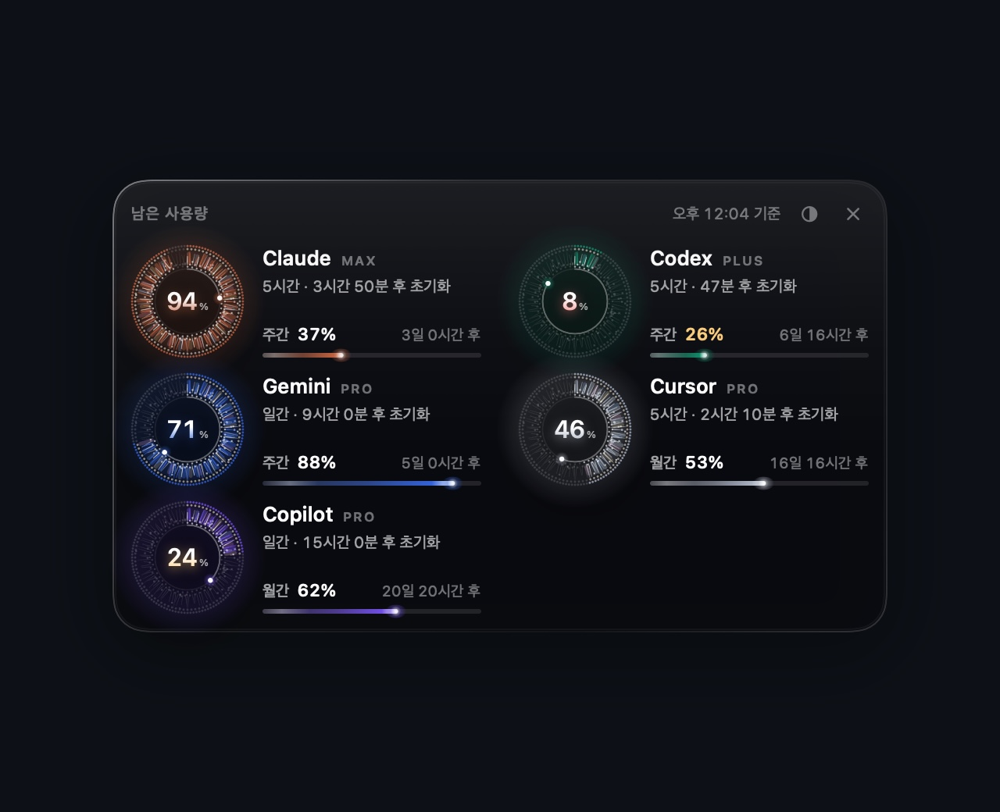
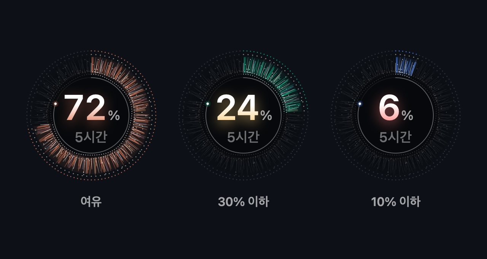
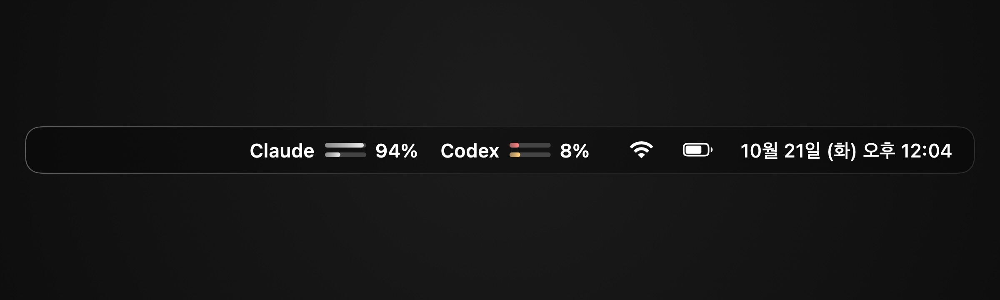
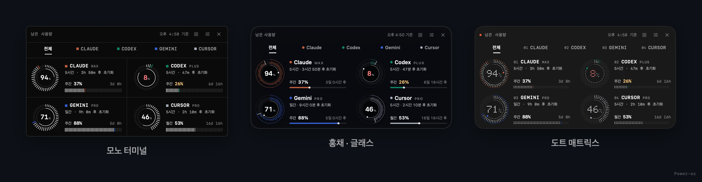

# usage-gauge

[](https://github.com/Power-xc/usage-gauge/actions/workflows/ci.yml)

[](windows/README.md)
[](LICENSE)

쓰고 있는 **모든 AI 서비스의 남은 사용량**을 화면 위에 떠 있는 유리 게이지와 메뉴바로 보여주는 앱입니다. Claude·Codex·Gemini·Cursor·Copilot·Windsurf·Grok·OpenRouter 등 [CodexBar](https://github.com/steipete/CodexBar)가 읽을 수 있는 100여 개 서비스를 한 패널에 모아, 한도가 얼마나 남았는지와 언제 초기화되는지를 작업 중에 시선만 돌려 확인할 수 있습니다.

<p align="center">
  
</p>

## 기능

- **모든 AI 서비스를 한 패널에** — CodexBar에서 켜 둔 서비스를 한 줄에 두 개씩 보여줍니다. 자주 쓰는 Claude와 Codex가 앞에 오고, 나머지는 켠 순서대로 이어집니다.
- **남은 사용량 다이얼** — 5시간·일간 같은 짧은 창은 다이얼로, 주간·월간 창은 옆의 바로 보여줍니다. 남은 만큼 다이얼과 바가 켜집니다.
- **스타일 3종** — 스모크 유리 위 홍채 다이얼, 무광 카드 위 도트 매트릭스, 검은 격자 위 모노 터미널 중에서 고르면 기억합니다. 어느 스타일이든 숫자와 규칙은 같습니다.
- **AI마다 고유색** — Claude 테라코타, Codex 에메랄드, Gemini 블루, Copilot 바이올렛처럼 서비스마다 깊은 고유색이 다이얼·바·유리 너머 빛에 입혀집니다. 전용 색이 없는 서비스도 이름에서 정해지는 고유한 색을 받아 늘 같은 색으로 보입니다.
- **초기화까지 남은 시간** — 동공 테두리가 시계 역할을 합니다. 창이 시작된 12시 방향부터 지금까지가 밝아지고, 점이 한 바퀴를 돌면 초기화됩니다. 옆에 "3시간 50분 후 초기화"처럼 글로도 표시합니다.
- **숫자로 먼저 알림** — 30% 이하는 노랑, 10% 이하는 산호색으로 숫자가 바뀝니다. 다이얼은 서비스 색을 그대로 지켜 어느 서비스인지 헷갈리지 않습니다.
- **메뉴바 세트** — 패널을 꺼 두어도 메뉴바에 서비스별 막대 두 줄(짧은 창·긴 창)과 남은 %가 항상 보입니다.
- **배경에 맞춘 유리** — 바탕화면이 밝으면 유리가 진해지고 어두우면 맑아집니다. 바탕화면 이미지 파일만 읽어서 권한이 필요 없습니다.
- **투명도 조절** — 패널의 ◐ 버튼을 누르면 나오는 바를 드래그하거나, 우클릭 메뉴의 슬라이더로 조절합니다.

| 연결한 모든 서비스                     | 남은 양에 따른 숫자 색        |
| -------------------------------------- | ----------------------------- |
|  |  |



## 스타일

우클릭 메뉴(또는 메뉴바 아이템 우클릭) → **스타일**에서 고릅니다. 고른 스타일은 다음 실행에도 그대로입니다.

| 스타일        | 표면                                    | 짧은 창                        | 긴 창        | 글자             |
| ------------- | --------------------------------------- | ------------------------------ | ------------ | ---------------- |
| 홍채 · 글래스 | 스모크 유리, 다이얼 뒤로 서비스 색 번짐 | 실크 결 홍채, 동공 테두리 시계 | 빛줄기 바    | 시스템 글꼴      |
| 도트 매트릭스 | 무광 차콜 카드, 왼쪽 위의 따뜻한 빛     | 점 기둥 고리, 점 숫자, 점 시계 | 두 줄 점 띠  | 고정폭, `3h 50m` |
| 모노 터미널   | 검은 판과 칸을 나누는 가는 격자선       | 방사 눈금, 안쪽 원 시계        | 세로 눈금 바 | 고정폭, `3h 50m` |



## 요구 사항 (macOS)

- macOS 14 이상 (Liquid Glass 유리는 macOS 26부터, 그 이전은 블러 유리로 대체)
- [CodexBar](https://codexbar.app) — 서비스별 사용량을 읽어 오는 CLI가 함께 설치됩니다
- Swift 5.9 이상 (Xcode 또는 Command Line Tools)

```sh
brew install --cask codexbar
```

CodexBar에서 보고 싶은 서비스를 켜고 로그인해 두면, 게이지에 그대로 나타납니다. 메뉴바 앱 자체는 켜 둘 필요가 없습니다 — 게이지는 CLI만 사용합니다.

## 설치 (macOS)

```sh
git clone https://github.com/Power-xc/usage-gauge.git
cd usage-gauge
scripts/install.sh
```

`~/Applications/UsageGauge.app`에 설치되고 로그인할 때 자동으로 켜집니다. 화면 기록이나 손쉬운 사용 권한은 묻지 않습니다. 지우려면 `scripts/uninstall.sh`를 실행합니다.

## Windows

같은 패널을 Windows 10/11에서도 씁니다. [`windows/`](windows/README.md)의 Tauri(Rust + TypeScript) 앱이 같은 다이얼·바·갱신 규칙을 그대로 옮겼고, 유리는 Windows 11 아크릴 블러 위에 깔립니다.

<p align="center">
  
</p>

- **지원 서비스** — CodexBar가 macOS 전용이라, Windows 판은 Claude Code와 Codex CLI의 로그인 파일로 각 서비스의 공식 사용량 응답을 직접 읽습니다. 지금은 Claude·Codex 두 서비스입니다.
- **설치** — [Actions의 windows 워크플로](https://github.com/Power-xc/usage-gauge/actions/workflows/windows.yml)에서 `UsageGauge-windows-installer`를 받아 실행하거나, `cd windows && npm ci && npm run tauri build`로 직접 빌드합니다.
- **사용** — 트레이 아이콘 클릭이나 `Ctrl+Alt+U`로 켜고 끄고, 트레이 메뉴에서 로그인 시 시작을 켭니다.
- **토큰** — 요청할 때마다 파일에서 읽어 `api.anthropic.com`·`chatgpt.com`으로만 HTTPS로 보내고, 기록·저장하거나 화면(웹뷰)에 넘기지 않습니다. 토큰을 갱신하거나 고치지도 않습니다.

## 사용법

| 동작             | 방법                                                      |
| ---------------- | --------------------------------------------------------- |
| 게이지 켜기/끄기 | 메뉴바 아이템 클릭 · `⌥⌘U` · 앱 다시 열기 · 패널의 ×      |
| 스타일           | 우클릭 메뉴 → 스타일 (홍채 · 도트 매트릭스 · 모노 터미널) |
| 투명도           | 패널의 ◐ 버튼 → 바 드래그, 또는 우클릭 메뉴 슬라이더      |
| 배경 맞춤 유리   | 우클릭 메뉴 → 배경에 맞춰 유리 진하기 조절                |
| 지금 새로고침    | 우클릭 메뉴 → 지금 새로고침                               |
| 위치 옮기기      | 머리글이나 서비스 카드를 드래그 (위치는 기억됩니다)       |

## 정확도

게이지는 사용량을 추정하지 않습니다. 각 서비스가 직접 보고한 값을 CodexBar CLI로 받아, 아래 규칙대로 해석만 합니다.

| 상황                    | 게이지의 처리                                                                                     |
| ----------------------- | ------------------------------------------------------------------------------------------------- |
| 언제 값인지             | 머리글의 "오후 1:51 기준"은 화면에 있는 값 중 **가장 오래된 측정 시각**입니다                     |
| 갱신 시점               | 2분마다, Mac이 깨어날 때, 패널을 열 때(마지막 측정이 1분보다 오래됐으면), 초기화 시각이 지난 직후 |
| 초기화 시각이 지남      | 다음 응답을 기다리지 않고 바로 100%로 바꾼 뒤, 곧바로 다시 읽어 확인합니다                        |
| 반올림                  | 조금이라도 남았으면 0%로, 조금이라도 썼으면 100%로 보이지 않습니다 (99.6% 사용 → 1%)              |
| 한 서비스의 요청이 실패 | 마지막 정상값을 유지하고, 기준 시각도 그 값의 측정 시각으로 남아 오래된 값임을 알 수 있습니다     |
| 한 번도 읽지 못함       | "연결 안 됨"과 이유를 보여줍니다                                                                  |
| 초기화까지 남은 시간    | 15초마다 다시 계산합니다                                                                          |

이 규칙은 `UsageGaugeCore`에 모여 있고, `swift run CoreChecks`의 44개 검사가 그대로 확인합니다.

## 아키텍처

<picture>
  <source media="(prefers-color-scheme: dark)" srcset="https://raw.githubusercontent.com/Power-xc/usage-gauge/main/docs/architecture-dark.svg">
  
</picture>

흐름은 두 갈래입니다. 위쪽은 **숫자**입니다 — CLI가 돌려준 JSON을 `UsageModel`이 남은 비율과 초기화 시각으로 해석하고, `UsageStore`가 갱신 시점과 마지막 정상값을 관리해 다이얼과 메뉴바에 넘깁니다. 아래쪽은 **표면**입니다 — 패널 뒤에 해당하는 바탕화면 영역의 밝기를 읽어 유리 진하기를 정하고, 고른 스타일에 따라 유리·무광 카드·터미널 격자 중 하나를 깝니다. 두 결과는 한 패널 안에서 겹쳐 그려집니다.

| 모듈             | 역할                                                                                          |
| ---------------- | --------------------------------------------------------------------------------------------- |
| `UsageGaugeCore` | CodexBar JSON 디코딩, 남은 비율·표시 반올림, 초기화 해석, 카운트다운, 배경 밝기 → 유리 진하기 |
| `UsageGaugeUI`   | 패널(`GaugeView`), 스타일 3종의 다이얼·바·표면(`PanelSurface`), 메뉴바 뷰                     |
| `UsageGauge`     | 앱 셸 — 패널·메뉴바·단축키·주기 갱신·바탕화면 밝기 판독                                       |
| `PromoRenderer`  | 실제 뷰를 샘플 데이터로 렌더해 README 이미지와 데모 GIF를 만듭니다                            |
| `CoreChecks`     | XCTest 없이 도는 검사 실행기 (`swift run CoreChecks`)                                         |
| `windows/`       | Windows 판 — Rust 쪽이 사용량을 읽고 해석하며, 같은 그림을 Canvas로 그립니다                  |

### 스택 선정 이유

- **Swift Package + SwiftUI/AppKit (2026-10-21)** — 떠 있는 비활성 패널(`NSPanel`)과 메뉴바 아이템은 AppKit이, 다이얼 같은 그림은 SwiftUI `Canvas`가 가장 적은 코드로 정확하게 그립니다. Xcode 프로젝트 없이 `swift build`만으로 빌드되어 Command Line Tools만 있는 Mac에서도 설치됩니다. macOS에서는 Electron·Tauri가 상시 떠 있는 작은 위젯에 비해 메모리와 시작 비용이 커서 제외했습니다.
- **Windows 판은 Tauri v2 (2026-10-21)** — SwiftUI가 없는 Windows에서 같은 다이얼을 그리기에는 Canvas가 가장 가깝고, Tauri는 OS에 이미 있는 WebView2를 써서 Electron보다 설치 파일과 메모리가 작습니다. 토큰을 다루는 사용량 읽기와 해석은 Rust 쪽에 두어 웹뷰가 토큰을 볼 일이 없게 했습니다.
- **CodexBar CLI를 데이터 원천으로 (2026-10-21)** — 서비스마다 다른 인증·사용량 API를 CodexBar가 이미 다루고 있어, 게이지는 표시와 해석에만 집중합니다. 각 서비스 API를 직접 부르는 방식은 토큰 보관과 API 변경 추적 부담이 커서 제외했습니다.

### 구조 선정 이유

- **판단 로직은 Core, 그림은 UI, 시스템 연결은 App** — 남은 비율 반올림, 초기화 시각이 지난 창의 해석, 배경 밝기 → 유리 진하기 같은 판단은 UI 없이 검사할 수 있도록 `UsageGaugeCore`에 둡니다. `CoreChecks`가 이 경계를 그대로 검사합니다.
- **README 이미지는 실제 뷰로 렌더** — `PromoRenderer`가 앱과 같은 SwiftUI 뷰를 샘플 데이터로 그려서, 데모와 실제 화면이 어긋나지 않습니다.

## 개발

```sh
swift build                 # 전체 빌드
swift run CoreChecks        # 판단 로직 검사
scripts/render-media.sh     # README 이미지와 데모 GIF 다시 렌더 (ffmpeg 필요)
cd windows && npm ci && npm run build && (cd src-tauri && cargo test)   # Windows 판 프런트·Rust 검사
```

## 라이선스

[MIT](LICENSE). 사용량 데이터는 [CodexBar](https://github.com/steipete/CodexBar)(MIT)의 CLI로 읽습니다.
