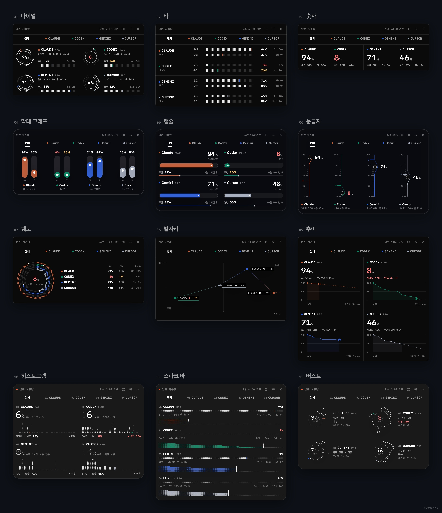
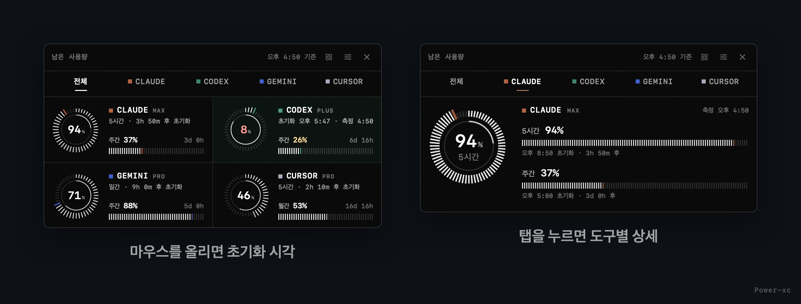

<div align="center">

# usage-gauge

**쓰는 모든 AI의 남은 한도를, 언제 바닥나는지까지.**

Claude · Codex · Gemini · Cursor · Copilot … 남은 사용량을 화면 위 게이지와 메뉴바에 띄웁니다.<br>
그래프 12종과 스타일 3종 중에서 원하는 모양으로.

[](https://github.com/Power-xc/usage-gauge/actions/workflows/ci.yml)
[](https://github.com/Power-xc/usage-gauge/releases/latest)


[](LICENSE)


**[다운로드](https://github.com/Power-xc/usage-gauge/releases/latest)** · [그래프 12종](#그래프-12종) · [스타일](#스타일-3종) · [설치](#설치) · [사용법](#사용법) · [English](README.en.md)

</div>

## 한눈에

- **모든 AI를 한 패널에** — [CodexBar](https://github.com/steipete/CodexBar)가 읽는 100여 개 서비스 중 켜 둔 것을 모두 모읍니다. Claude와 Codex가 앞에, 나머지는 켠 순서대로 이어집니다.
- **언제 바닥나는지 미리** — 최근 1시간 동안 쓴 속도로 "28분 후 소진"을 계산합니다. 초기화 전까지 넉넉하면 "여유"라고 알려 줍니다.
- **그래프 12종 × 스타일 3종** — 다이얼부터 추이 곡선, 히스토그램, 별자리까지. 모노 터미널, 홍채, 도트 매트릭스 중 취향대로 고르면 기억합니다.
- **만지면 반응** — 서비스 탭을 누르면 상세가 열리고, 마우스를 올리면 초기화 시각이 드러나고, 머리글에서 그래프를 바로 바꿉니다. 크기는 0.7–1.6배.
- **메뉴바에도 항상** — 패널을 꺼 둬도 서비스별 두 줄 막대와 남은 %가 메뉴바에 보입니다.
- **권한도 토큰도 필요 없음** — 화면 기록이나 손쉬운 사용 권한을 묻지 않고, 계정 토큰을 읽거나 저장하지 않습니다.

## 그래프 12종

같은 숫자를 열두 가지 모양으로 봅니다. 머리글의 **그래프 모양** 버튼이나 메뉴 → **그래프**에서 바꿉니다.



| 그래프      | 보여 주는 것                                               | 이럴 때                   |
| ----------- | ---------------------------------------------------------- | ------------------------- |
| 다이얼      | 짧은 창(5시간·일간)은 다이얼, 긴 창(주간·월간)은 막대      | 기본. 두 창을 함께        |
| 바          | 두 창을 가로 막대 두 줄로                                  | 서비스가 많을 때 촘촘하게 |
| 숫자        | 큰 숫자 하나와 한 줄 요약                                  | 가장 작게 띄워 둘 때      |
| 막대 그래프 | 서비스마다 두 창을 세로 막대로 나란히                      | 서비스끼리 비교할 때      |
| 캡슐        | 알약 모양 배터리에 남은 만큼                               | 한눈에 직관적으로         |
| 눈금자      | 눈금 위로 올라온 선이 지금 값에서 불룩 휘고, 옆에 큰 숫자  | 정확한 값을 크게          |
| 궤도        | 모든 서비스를 동심원 하나에, 가장 적게 남은 값을 가운데에  | 제일 급한 서비스 찾기     |
| 별자리      | 짧은 창 × 긴 창 남은 양 지도와 지난 1시간 동안 움직인 궤적 | 여유·부족을 한 장에       |
| 추이        | 이번 창에서 남은 양이 줄어든 곡선과 소진 예상선            | 언제 바닥나는지           |
| 히스토그램  | 시간대별로 쓴 양                                           | 언제 몰아서 썼는지        |
| 스파크 바   | 남은 양 막대 아래로 시간별 기록 띠                         | 목록으로 흐름까지         |
| 버스트      | 창을 시계처럼 두르고 시간대별 사용량을 방사선으로          | 하루의 리듬               |

추이·히스토그램·스파크 바·버스트·별자리 궤적은 앱이 2분마다 쌓는 기록으로 그립니다. 설치 직후에는 "기록 중"으로 보이다가 몇 분 안에 채워집니다.

## 스타일 3종

메뉴 → **스타일**에서 고릅니다. 어느 스타일이든 숫자와 규칙은 같습니다.


| 스타일             | 표면                              | 그림                                          |
| ------------------ | --------------------------------- | --------------------------------------------- |
| 모노 터미널 (기본) | 검은 판과 칸을 나누는 가는 격자선 | 방사 눈금 다이얼, 세로 눈금 막대, 고정폭 숫자 |
| 홍채 · 글래스      | 회색 없이 맑은 스모크 유리        | 또렷한 단색 결의 홍채 다이얼, 가는 막대       |
| 도트 매트릭스      | 평평한 숯색 카드                  | 점 기둥 고리, LED 점 숫자, 점 띠              |

서비스마다 고유색이 있습니다 — Claude 테라코타, Codex 에메랄드, Gemini 블루, Copilot 바이올렛. 전용 색이 없는 서비스도 이름에서 정해지는 색을 늘 같게 받습니다. 남은 양이 30% 이하면 숫자가 노랑, 10% 이하면 산호색으로 바뀝니다.

## 설치

### macOS 14 이상

macOS 26에서는 Liquid Glass 유리로, 그 이전 버전에서는 블러 유리로 그립니다.

1. **CodexBar 설치** — 서비스별 사용량을 읽어 오는 CLI입니다. 설치한 뒤 보고 싶은 서비스에 로그인해 둡니다. CodexBar 앱 자체는 켜 둘 필요가 없습니다.

   ```sh
   brew install --cask codexbar
   ```

2. **앱 받기** — [Releases](https://github.com/Power-xc/usage-gauge/releases/latest)에서 `UsageGauge-macOS.zip`을 받아 풀고 `UsageGauge.app`을 응용 프로그램 폴더로 옮깁니다. Apple silicon과 Intel 겸용입니다.

3. **처음 열기** — Apple 공증을 받지 않은 오픈소스 앱이라 처음 열 때 경고가 뜹니다. 시스템 설정 → 개인정보 보호 및 보안 맨 아래의 **그래도 열기**를 누릅니다. 터미널이 편하면 아래 한 줄로도 됩니다.

   ```sh
   xattr -dr com.apple.quarantine /Applications/UsageGauge.app
   ```

처음 실행하면 로그인할 때 자동으로 켜지도록 등록됩니다. 메뉴의 **로그인할 때 켜기**로 끄고 켭니다.

<details>
<summary>소스로 빌드해서 설치</summary>

Swift 5.9 이상(Xcode 또는 Command Line Tools)이 필요합니다.

```sh
git clone https://github.com/Power-xc/usage-gauge.git
cd usage-gauge
scripts/install.sh      # ~/Applications에 설치하고 실행
scripts/uninstall.sh    # 지우기
```

</details>

### Windows 10/11

[Releases](https://github.com/Power-xc/usage-gauge/releases/latest)에서 `UsageGauge_…_x64-setup.exe`를 받아 실행합니다. "Windows의 PC 보호" 화면이 뜨면 **추가 정보 → 실행**을 누릅니다.

Windows 판은 CodexBar 대신 Claude Code와 Codex CLI의 로그인 파일로 두 서비스의 공식 사용량을 직접 읽습니다. 그래프·스타일·인터랙션은 macOS와 같고, 트레이 아이콘 클릭이나 `Ctrl+Alt+U`로 켜고 끕니다.

## 사용법



| 동작             | 방법                                                            |
| ---------------- | --------------------------------------------------------------- |
| 게이지 켜기/끄기 | 메뉴바 아이템 클릭 · `⌥⌘U` · 패널의 ×                           |
| 서비스 상세      | 탭이나 서비스 칸을 클릭, **전체**로 돌아오기                    |
| 초기화 시각 보기 | 서비스 칸에 마우스를 올리기                                     |
| 그래프 바꾸기    | 머리글의 그래프 모양 버튼, 또는 메뉴 → 그래프                   |
| 스타일 바꾸기    | 메뉴 → 스타일                                                   |
| 크기·투명도      | 머리글의 투명도 · 크기 버튼 → 막대 드래그, 또는 메뉴의 슬라이더 |
| 옮기기           | 머리글이나 칸을 드래그 (놓은 자리를 기억)                       |
| 메뉴바 막대      | 메뉴 → 메뉴바에 막대 표시                                       |
| 로그인할 때 켜기 | 메뉴 → 로그인할 때 켜기                                         |
| 배경 맞춤 유리   | 메뉴 → 배경에 맞춰 유리 진하기 조절                             |
| 지금 새로고침    | 메뉴 → 지금 새로고침                                            |

메뉴는 메뉴바 아이템이나 패널을 우클릭하면 열립니다.


## 데이터와 개인정보

- **숫자는 각 서비스가 보고한 값 그대로** — CodexBar CLI가 받아 온 공식 값을 해석만 하고 추정하지 않습니다. 2분마다, Mac이 깨어날 때, 패널을 열 때, 초기화 시각이 지난 직후에 다시 읽습니다. 머리글의 "오후 4:50 기준"은 화면에 있는 값 중 가장 오래된 측정 시각입니다.
- **기록은 내 Mac에만** — 소진 예상과 기록 그래프를 위해 서비스 이름·측정 시각·남은 %만 최근 26시간 동안 `~/Library/Application Support/UsageGauge/history.json`에 저장합니다. 파일을 지우면 처음부터 다시 쌓입니다.
- **토큰은 건드리지 않음** — macOS 판은 계정 토큰을 읽지도 저장하지도 않습니다(로그인은 CodexBar가 다룹니다). Windows 판은 요청할 때마다 로그인 파일에서 토큰을 읽어 `api.anthropic.com`·`chatgpt.com`으로만 HTTPS로 보내고, 기록·저장·갱신하거나 화면에 넘기지 않습니다.
- **권한 없음** — 유리 진하기는 바탕화면 이미지 파일의 밝기로만 맞춰, 화면 기록 권한이 필요 없습니다.

<details>
<summary>숫자를 해석하는 규칙</summary>

| 상황                    | 게이지의 처리                                                                                  |
| ----------------------- | ---------------------------------------------------------------------------------------------- |
| 초기화 시각이 지남      | 다음 응답을 기다리지 않고 바로 100%로 바꾼 뒤, 곧바로 다시 읽어 확인합니다                     |
| 반올림                  | 조금이라도 남았으면 0%로, 조금이라도 썼으면 100%로 보이지 않습니다 (99.6% 사용 → 1%)           |
| 한 서비스의 요청이 실패 | 마지막 정상값을 유지하고, 기준 시각도 그 값의 측정 시각으로 남아 오래된 값임을 알 수 있습니다  |
| 한 번도 읽지 못함       | "연결 안 됨"과 이유를 보여 줍니다                                                              |
| 소진 예상               | 지난 1시간 동안 10분 이상 기록이 쌓이고 실제로 줄었을 때만 계산하고, 초기화가 먼저 오면 "여유" |
| 초기화까지 남은 시간    | 15초마다 다시 계산합니다                                                                       |

이 규칙은 모두 `UsageGaugeCore`에 있고, `swift run CoreChecks`가 그대로 검사합니다.

</details>

## 개발

```sh
swift build && swift run CoreChecks       # 빌드와 판단 로직 검사
scripts/render-media.sh                    # README 이미지와 데모 GIF 렌더 (ffmpeg 필요)
cd windows && npm ci && npm run build && (cd src-tauri && cargo test)
```

README의 이미지와 데모는 모두 앱과 같은 SwiftUI 뷰를 샘플 데이터로 렌더한 것입니다.

## 라이선스

[MIT](LICENSE). 사용량 데이터는 [CodexBar](https://github.com/steipete/CodexBar)(MIT)의 CLI로 읽습니다.
