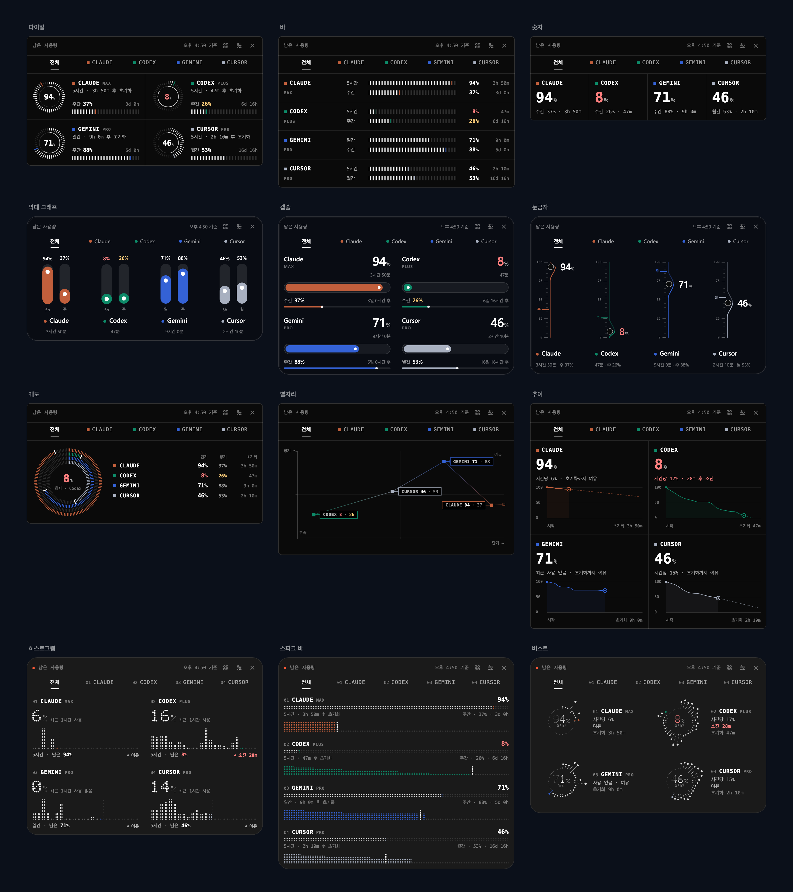
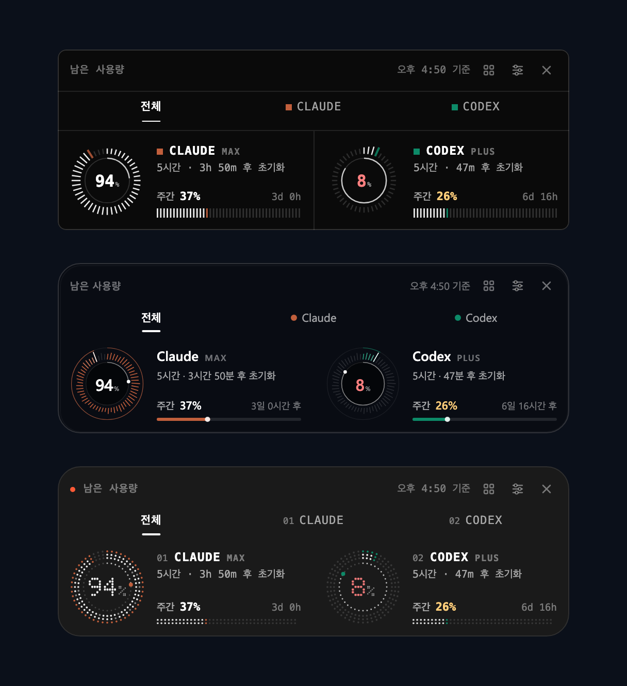
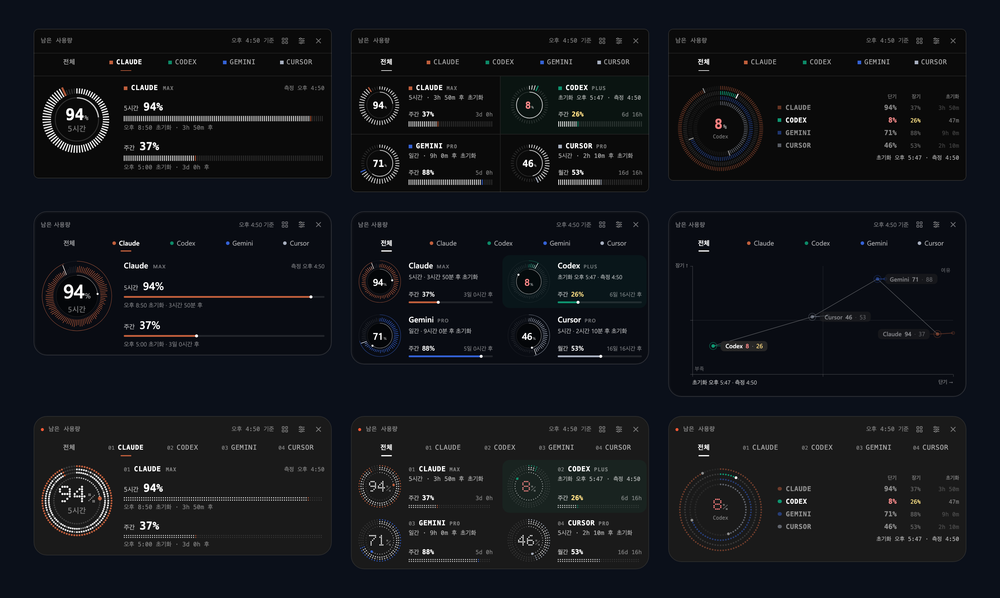

# UsageGauge (Windows)

Claude와 Codex의 **남은 사용량**을 화면 위에 떠 있는 작은 패널과 트레이 아이콘으로 보여주는 Windows 앱입니다.


## 설치

1. [최신 릴리스](https://github.com/Power-xc/usage-gauge/releases/latest)에서 `UsageGauge_1.0.0_x64-setup.exe`를 받아 실행합니다.
2. Windows SmartScreen이 "PC를 보호했습니다"라고 하면 **추가 정보 → 실행**을 누릅니다.

필요한 것:

- Windows 10 / 11 (유리 효과는 Windows 11의 아크릴 블러이고, 그 밖에는 짙은 반투명 배경으로 대신합니다)
- WebView2 (Windows 11에는 기본으로 들어 있습니다)
- Claude Code와 Codex CLI 중 하나 이상에 로그인된 상태. 로그인이 없는 도구는 "연결 안 됨"으로 표시됩니다.

## 사용법

| 하고 싶은 일            | 방법                                                                                                     |
| ----------------------- | -------------------------------------------------------------------------------------------------------- |
| 패널 켜기 / 끄기        | 트레이 아이콘 왼쪽 클릭 · `Ctrl+Alt+U` · 패널의 ×                                                        |
| 도구 하나만 크게 보기   | 머리글 아래 탭(전체 + 도구별)이나 도구 칸을 클릭                                                         |
| 초기화 · 측정 시각 보기 | 도구 칸에 포인터를 올리면 칸이 밝아지고, 그 자리의 설명 줄이 "초기화 오후 5:47 · 측정 4:50"으로 바뀝니다 |
| 그래프 모양 바꾸기      | 머리글의 그래프(▦) 버튼에서 선택                                                                         |
| 투명도 · 크기           | 머리글의 조절(≡) 버튼 → 투명도 30–100%, 크기 70–160% 바를 끌기                                           |
| 위치 옮기기             | 머리글이나 본문을 끌기 (위치는 기억됩니다)                                                               |
| 트레이 메뉴             | 우클릭 → 스타일 · 그래프 · 지금 새로고침 · 로그인 시 시작 · 종료                                         |

숫자는 2분마다, 절전에서 깨어날 때, 패널을 다시 열 때(마지막 갱신이 60초 넘었다면) 새로 읽습니다. 초기화 시각이 지나면 바로 100%로 바뀝니다. 트레이 툴팁에는 "Claude 94% · Codex 8%"처럼 짧은 창의 남은 양이 나옵니다.

## 그래프 12종



다이얼 · 바 · 숫자 · 막대 그래프 · 캡슐 · 눈금자 · 궤도 · 별자리 · 추이 · 히스토그램 · 스파크 바 · 버스트. 트레이 메뉴의 **그래프**나 머리글의 ▦ 버튼에서 고르며, 선택은 다음 실행에도 기억됩니다.

| 그래프      | 보여주는 것                                                                                                                               |
| ----------- | ----------------------------------------------------------------------------------------------------------------------------------------- |
| 다이얼      | 도구마다 단기 창은 다이얼, 장기 창은 막대                                                                                                 |
| 바          | 도구마다 두 창을 이름 붙은 막대로 나란히                                                                                                  |
| 숫자        | 단기 창의 큰 숫자와 장기 창 한 줄                                                                                                         |
| 막대 그래프 | 모든 도구의 두 창을 세로 막대로 비교                                                                                                      |
| 캡슐        | 단기 창만큼 채운 캡슐 아래에 장기 창                                                                                                      |
| 눈금자      | 도구마다 세로 눈금자와 단기 창 위치의 손잡이                                                                                              |
| 궤도        | 도구마다 고리 하나, 가장 낮은 값이 가운데, 옆에 범례                                                                                      |
| 별자리      | 단기 창은 가로, 장기 창은 세로인 한 장의 지도에 도구를 점으로 찍어 선으로 연결. 사용 기록이 있으면 1시간 전 자리에서 오는 궤적이 보입니다 |
| 추이        | 도구마다 단기 창이 기간 동안 줄어든 곡선                                                                                                  |
| 히스토그램  | 도구마다 최근 사용량을 세로 기둥으로                                                                                                      |
| 스파크 바   | 도구마다 막대 하나와 시간에 따라 남은 양의 띠                                                                                             |
| 버스트      | 도구마다 사용량을 방사형 광선으로                                                                                                         |

추이 · 히스토그램 · 스파크 바 · 버스트 · 별자리의 궤적은 아래 "데이터와 토큰"의 사용 기록을 씁니다. 기록이 쌓이기 전에는 그 부분이 비어 있습니다. 궤도와 별자리는 도구 하나(고리 또는 점·이름표, 범례 줄)에 올리면 그 도구만 밝아지고 나머지는 흐려지며, 누르면 그 도구의 탭이 열립니다.

## 스타일 3종



트레이 메뉴의 **스타일**에서 고릅니다.

- **모노 터미널** (기본): 가는 선과 눈금, 고정폭 글꼴
- **홍채 · 글래스**: 그라데이션이나 번짐 없이 단색 선과 면으로 그린 반투명 유리 패널
- **도트 매트릭스**: 점으로 이루어진 숫자와 막대

숫자는 어느 스타일에서나 같고, 표면·다이얼·막대·글꼴만 달라집니다.

탭과 상세 페이지, 포인터를 올렸을 때의 모습은 다음과 같습니다.



## 데이터와 토큰

각 도구가 이미 가진 로그인 파일을 읽어 Claude와 Codex의 공식 사용량 엔드포인트에 요청합니다.

| 도구   | 로그인 파일                                                      | 요청                                                                                                          |
| ------ | ---------------------------------------------------------------- | ------------------------------------------------------------------------------------------------------------- |
| Claude | `%USERPROFILE%\.claude\.credentials.json`                        | `GET https://api.anthropic.com/api/oauth/usage` (`Authorization: Bearer`, `anthropic-beta: oauth-2025-04-20`) |
| Codex  | `%CODEX_HOME%\auth.json` (기본 `%USERPROFILE%\.codex\auth.json`) | `GET https://chatgpt.com/backend-api/wham/usage` (`Authorization: Bearer`, `ChatGPT-Account-Id`)              |

- 토큰은 요청할 때마다 파일에서 읽어 위 두 호스트로만 HTTPS로 보냅니다.
- 토큰을 기록하거나 저장하거나 화면(웹뷰)에 넘기지 않고, 갱신하거나 파일을 고치지도 않습니다.
- 인증이 거절되면(401/403) "Claude Code에서 다시 로그인하세요"처럼 안내합니다.

**사용 기록**: 추이·히스토그램·스파크 바·버스트·별자리의 궤적을 위해 앱 데이터 폴더(`%APPDATA%\io.github.power-xc.usage-gauge`)의 `history.json`에 도구 id · 시각 · 남은 %만 26시간 동안 남깁니다. 토큰과 계정 정보는 들어 있지 않습니다. 이 파일을 지우면 기록이 처음부터 다시 쌓입니다.

## 소스에서 빌드

[Node.js](https://nodejs.org), [Rust](https://rustup.rs), WebView2가 필요합니다. 아래는 모두 `windows` 폴더에서 실행합니다.

```sh
npm ci
npm run tauri build          # src-tauri/target/release/bundle/nsis/ 에 설치 파일 생성
npm run build && npm run check      # 화면 동작 점검 (헤드리스 Chrome 필요)
(cd src-tauri && cargo test)        # Rust 테스트
npm run build && npm run preview    # 위의 미리보기 이미지 다시 만들기
```

개발 중에는 `npm run tauri dev`를 씁니다.
