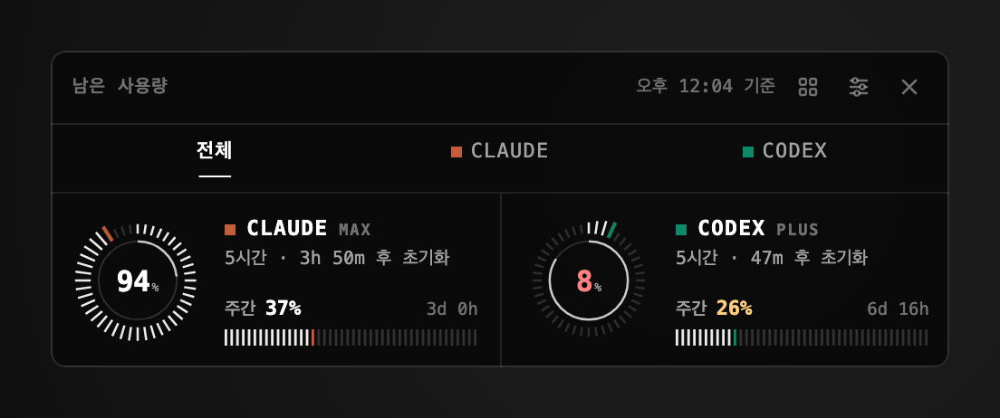

# UsageGauge (Windows)

Claude·Codex의 **남은 사용량**을 화면 위에 떠 있는 유리 게이지와 트레이 아이콘으로 보여주는 Windows 앱입니다. macOS 앱과 같은 디자인과 동작을 Tauri(Rust + TypeScript)로 옮겼습니다.



## 요구 사항

- Windows 10 / 11 (유리 효과는 Windows 11의 아크릴 블러, 그 외에는 짙은 연기색으로 대체)
- Claude Code 또는 Codex CLI 중 하나 이상에 로그인된 상태 (둘 다 없으면 해당 카드가 "연결 안 됨"으로 표시됩니다)

## 설치

**CI 빌드 받기** — GitHub의 Actions → `windows` 워크플로 실행 → Artifacts의 `UsageGauge-windows-installer`를 받아 설치 파일(`.exe`)을 실행합니다.

**소스에서 빌드** — [Node.js](https://nodejs.org), [Rust](https://rustup.rs), WebView2(Windows 11에 기본 포함)가 필요합니다.

```sh
cd windows
npm ci
npm run tauri build     # src-tauri/target/release/bundle/nsis/ 에 설치 파일 생성
```

개발 중에는 `npm run tauri dev`, 테스트는 `cd src-tauri && cargo test`, 화면 미리보기는 `npm run build && npm run preview`(`preview.png`, `preview-styles.png`, `preview-layouts.png`, `preview-shapes.png`, `preview-history.png`, `preview-interaction.png` 생성)입니다.

## 사용법

| 동작 | 방법 |
| --- | --- |
| 게이지 켜기/끄기 | 트레이 아이콘 왼쪽 클릭 · `Ctrl+Alt+U` · 패널의 × |
| 투명도 (30–100%) · 크기 (70–160%) | 패널의 조절(≡) 버튼 → 바 드래그 |
| 지금 새로고침 | 트레이 아이콘 우클릭 → 지금 새로고침 |
| 로그인 시 시작 | 트레이 아이콘 우클릭 → 로그인 시 시작 |
| 위치 옮기기 | 패널 머리글이나 다이얼 영역을 드래그 (위치는 기억됩니다) |
| 종료 | 트레이 아이콘 우클릭 → 종료 |

## 스타일

트레이 아이콘 우클릭 → **스타일**에서 패널의 모양을 고릅니다. **모노 터미널**(기본), **홍채 · 글래스**, **도트 매트릭스** 세 가지이며 숫자는 같고 표면·다이얼·막대·글꼴만 바뀝니다. 고르면 바로 적용되고 다음 실행에도 기억됩니다. 세 스타일을 나란히 본 모습은 [preview-styles.png](preview-styles.png)입니다.

## 그래프

트레이 아이콘 우클릭 → **그래프**에서 도구를 늘어놓는 방식을 고릅니다. **다이얼**(기본), **바**, **막대 그래프**, **숫자**, **궤도**, **캡슐**, **별자리**, **눈금자** 여덟 가지이며 어떤 스타일에서도 같은 숫자를 보여줍니다. 모아 보면 [preview-layouts.png](preview-layouts.png), 궤도·캡슐·별자리·눈금자를 세 스타일로 보면 [preview-shapes.png](preview-shapes.png)입니다. 별자리의 1시간 전 궤적은 사용 기록이 쌓이면 나타납니다.

## 탭과 상세 페이지

도구가 둘 이상이면 머리글 아래에 **전체**와 도구별 탭이 생기고, 고른 탭 밑에 도구 고유색의 밑줄이 미끄러져 옮겨 갑니다. 도구가 많으면 이름이 줄어들다가 표식만 남아 서로 겹치지 않습니다. 탭이나 도구 칸을 누르면 큰 다이얼, 두 창의 남은 양·초기화 시각·카운트다운, 측정 시각이 한 페이지에 나옵니다. 도구 칸에 포인터를 올리면 그 칸이 살짝 밝아지며 초기화 · 측정 시각 한 줄이 제자리에 나타납니다. 머리글의 그래프 모양(▦) 버튼은 열두 가지 그래프를 바로 고르게 하며 트레이의 **그래프** 항목과 같은 설정을 씁니다. 값이 바뀌면 다이얼과 막대가 부드럽게 움직이고, 페이지 전환은 크로스페이드로, 창 크기는 부드럽게 따라가며, 시스템의 "동작 줄이기" 설정을 따릅니다. 이 동작은 `npm run build && npm run check`로 점검하고 모습은 [preview-interaction.png](preview-interaction.png)입니다.

## 크기

패널 머리글의 조절(≡) 버튼을 누르면 투명도 바 아래에 **크기** 바가 나타납니다. 70–160% 범위에서 끌어 조절하면 글자와 그래프가 선명한 채로 커지거나 작아지고, 창은 내용에 맞게 늘어나며 화면 밖으로 나가지 않도록 안쪽으로 밀립니다. 고른 크기는 다음 실행에도 기억됩니다.

숫자는 2분마다, 절전에서 깨어날 때, 그리고 패널을 다시 열 때(마지막 갱신이 60초 넘었다면) 새로 읽습니다. 초기화 시각이 지나면 다음 갱신을 기다리지 않고 바로 100%로 바뀝니다. 트레이 툴팁에는 "Claude 94% · Codex 8%"처럼 짧은 창의 남은 양이 표시됩니다.

## 데이터 출처

Windows에는 CodexBar가 없으므로 각 도구가 이미 가진 로그인 정보와 공식 사용량 엔드포인트를 직접 사용합니다. 요청 형식은 [CodexBar](https://github.com/steipete/CodexBar) 소스를 따랐습니다.

| 도구 | 로그인 파일 | 요청 |
| --- | --- | --- |
| Claude | `%USERPROFILE%\.claude\.credentials.json` | `GET https://api.anthropic.com/api/oauth/usage` (`Authorization: Bearer`, `anthropic-beta: oauth-2025-04-20`) |
| Codex | `%CODEX_HOME%\auth.json` (기본 `%USERPROFILE%\.codex\auth.json`) | `GET https://chatgpt.com/backend-api/wham/usage` (`Authorization: Bearer`, `ChatGPT-Account-Id`) |

토큰은 요청할 때마다 파일에서 읽어 위 두 호스트로만 HTTPS로 보내며, 기록하거나 저장하거나 화면(웹뷰)에 넘기지 않습니다. 토큰을 갱신하거나 수정하지도 않습니다. 인증이 거절되면(401/403) "Claude Code에서 다시 로그인하세요"처럼 안내합니다.
